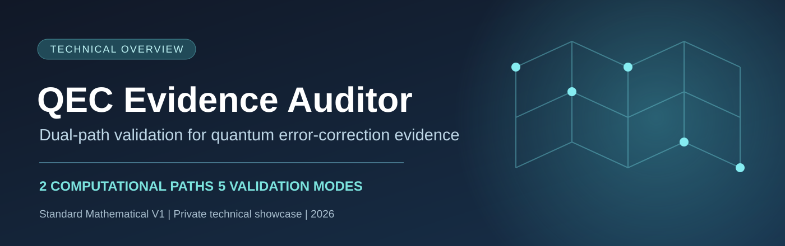
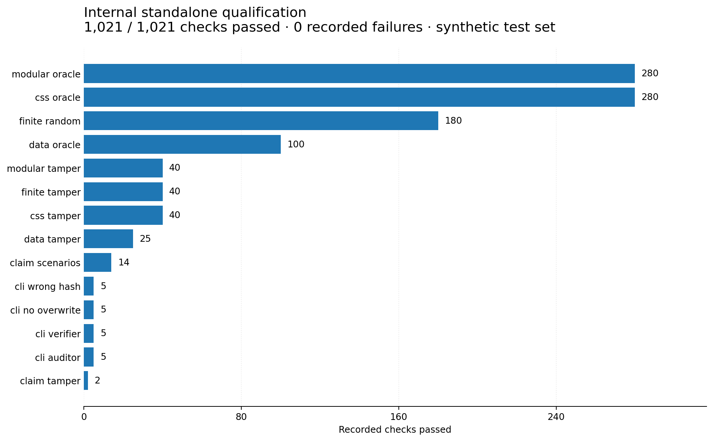
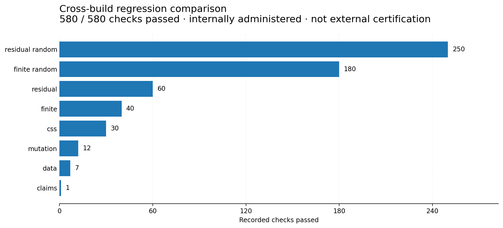

  

# QEC Evidence Auditor — Standard Mathematical V1

### Verify the evidence. Preserve the boundaries of the claim.

**Two computationally separate offline programs** designed to examine declared quantum-error-correction (QEC) artifacts and independently recheck the resulting mathematical evidence.

**Edition:** Standard Mathematical V1 · **Status:** Documentation showcase; evaluation by agreement · **Repository type:** Private technical showcase — **no source code or executable distribution included**.

> In a QEC workflow, a reported result and its independently recomputable evidence are not the same thing. QEC Evidence Auditor is built around that distinction.

## The two-program architecture

| Component | Role | Boundary |
|---|---|---|
| **Auditor** | Reads declared inputs and constructs a structured evidence record | Produces scoped mathematical findings; cannot certify unknown external facts |
| **Verifier** | Uses an independent calculation path to check submitted evidence | Confirms or rejects the *evidence*, not the physical authenticity of a device |

The implementation line is fully offline and uses only standard-library Python. The separately delivered programs do not import each other's calculation engine.

## Five supported modes

| Mode | What it checks | Mathematical basis |
|---|---|---|
| `claims` | Explicitly supplied claims and supported witnesses | Recalculation of parity, counters and declared conditions |
| `css` | Binary check matrices, commutation and syndromes | GF(2) linear algebra |
| `data` | Row identity, missing or altered records, duplicate-key ambiguity | Deterministic table reconciliation |
| `finite` | Declared finite-state models and candidate consistency | Exhaustive enumeration of supplied states |
| `residual` | Bounded modular expressions | Integer modular arithmetic |

Scope matters. For example, `css` does not claim to establish arbitrary code distance, and `finite` does not claim that the model contains every physically possible state.

## Validation evidence — internal, not external certification

**Evidence provenance:** figures below are transcribed from the supplied Standard Mathematical V1 qualification summary. The category totals were checked during showcase preparation. Raw run logs, test code and product binaries are not included; these tests were not rerun for this documentation release.

| Validation layer | Recorded outcome | Interpretation |
|---|---:|---|
| Standalone synthetic checks | **1,021 / 1,021 passed** | No failures in the recorded internal test suite |
| Regression/comparison checks | **580 / 580 passed** | No unexpected mathematical discrepancy on the comparison set |
| External independent certification | **Not performed** | Neither a third-party audit nor universal reliability is claimed |
| New quantum-hardware holdout | **Not performed** | No claim of hardware performance improvement |

### Standalone test distribution

### Comparison/regression test distribution

**Reading the plots:** these are counts of checks executed and passed, **not** error rates, scientific accuracy percentages, or benchmarks against competing quantum-hardware products. Comparison inputs and the private build are not shipped here; these figures are a transparent summary of an internal qualification report.

## Where the product is useful

- Internal consistency reviews of declared QEC artifacts.
- Research-team evaluation of syndrome and code-matrix data.
- Independent verification of produced evidence files.
- Integrity checks of post-processed experimental tables.
- Controlled technical evaluation before a deeper partner pilot.

## What this release does *not* claim

- No physical QEC error-rate reduction is demonstrated by this tool.
- No external laboratory accreditation or certification.
- No automatic truth guarantee for unsupported claims or incomplete physical metadata.
- `CONFIRMED` may legitimately confirm a negative audit finding (`FAIL`). It is not synonymous with device success.

## Technical documentation

- [Product architecture](docs/ARCHITECTURE.md)
- [Scientific scope and limitations](docs/SCIENTIFIC_SCOPE.md)
- [Qualification report](docs/VALIDATION_REPORT.md)
- [Evaluation and licensing](docs/EVALUATION_AND_LICENSING.md)
- [Product overview](docs/PRODUCT_OVERVIEW.md)
- [Technical report](docs/TECHNICAL_REPORT.md)
- [Demonstration guide](docs/DEMONSTRATION.md)
- [Changelog](CHANGELOG.md) · [Roadmap](ROADMAP.md)

## Evaluation and commercial licensing

**The software itself is not published in this repository.** Authorized repository collaborators may open a non-confidential issue to request an evaluation or pilot. Other interested parties need an owner-approved contact channel; this private repository is not publicly accessible.

*Documentation and visual assets only. All rights reserved.*
