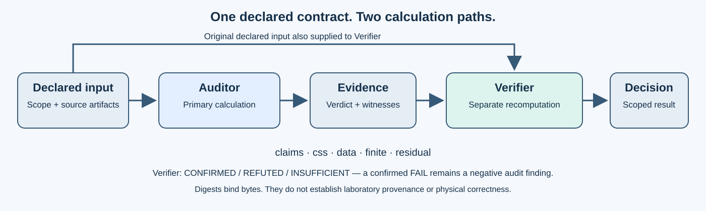

# Architecture — Two Separate Computational Paths

**Auditor** evaluates the explicitly declared mathematical contract and produces a structured record with its verdict, calculations, and supported witnesses.

**Verifier** receives the declared input and the evidence file. It independently recomputes supported properties through a separate standard-mathematical implementation and confirms, refutes, or marks the evidence as insufficient.

## Operational properties

- Offline processing, no network calls.
- Python 3.10+ standard library; no third-party Python dependencies.
- Both programs are packaged and run separately in the private evaluation line.
- Fresh output paths are required; no silent overwriting of evidence files.
- Input and evidence file byte identity can be pinned to a separately trusted SHA-256 digest.

## Interpretation of verdicts

The verifier may say **CONFIRMED** when the Auditor finds a genuine **FAIL**. This means the negative finding was reproducible — *not* that the audited system is healthy. Invalid or unsupported claims are rejected or marked **INSUFFICIENT**, depending on the declared mode.

A hash, an internally consistent report and agreement between two code paths cannot alone establish laboratory provenance, physical correctness or statistical independence.
